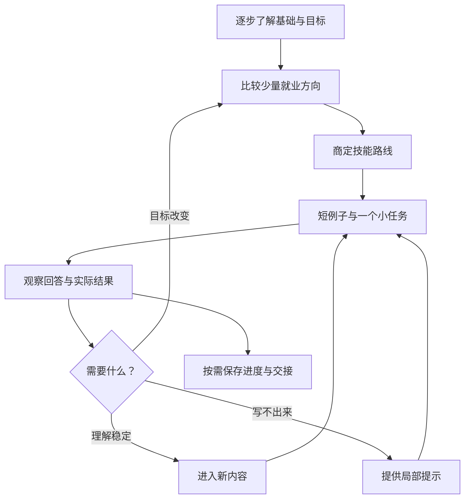

<div align="center">

# 🌱 Career to Code

### 从就业方向，到你的第一段独立代码

先了解你，再决定学什么。一次一个小任务，把“看得懂”变成“做得到”。

**职业探索 · 个性化路线 · 启发式教学 · 进度交接**

[快速开始](#快速开始) · [教学方法](#教学方法) · [对话示例](examples/conversations.md) · [技能入口](SKILL.md)

</div>

---

## 为什么做这个技能？

“我在读研究生，但不知道该准备什么岗位。”

“视频太长，文档太难；代码看懂了，自己却写不出来。”

“每周只有十小时，学习路线却列了十几个框架。”

Career to Code 从这些具体困惑出发，帮助 AI 老师先了解学习者，再选择方向、设计路线和持续教学。

一个可复用的 AI 教学技能：通过逐步对话明确就业方向，把目标转成技能路线，再用短例子、小任务和真实反馈持续教学。适合研究生、编程初学者，以及“能看懂但写不出”的学习者。

支持从零探索，也支持拿着已有路线直接续学；不限定 Java，不承诺就业结果。

## 快速开始

### 在支持 Skills 的工具中安装

仓库根目录就是完整技能。把内容下载或克隆到宿主的技能目录，文件夹命名为 `career-to-code`，保留目录结构。

例如，在采用 `~/.codex/skills` 的本地 Codex 环境中：

```bash
git clone https://github.com/muliuqing999/career-to-code.git ~/.codex/skills/career-to-code
```

Windows PowerShell 示例：

```powershell
git clone https://github.com/muliuqing999/career-to-code.git "$HOME/.codex/skills/career-to-code"
```

使用自定义技能目录时应调整路径；目标文件夹已存在时不要直接覆盖。按宿主要求重新加载或开始新聊天，其他工具的支持和安装规则以其文档为准。

### 在普通 AI 聊天中使用

上传 `SKILL.md` 和 `references/` 中的三个文件，告诉 AI 按文档教学；不能上传时可复制内容。仅提供仓库链接不保证 AI 能读到全部文件，先确认其访问能力。这种使用方式不等于宿主已经安装技能。

### 三种开场方式

**还没确定方向：**

```text
使用 $career-to-code。我在读研究生，不知道适合什么技术方向。
请先逐步了解我的基础和就业目标，再帮我确定学习内容。
```

**已有学习进度：**

```text
使用 $career-to-code。我每周有十小时，Java SE 已学完，正在学 Spring Boot 路径传参。
请接续当前进度，用一个小型内容管理项目教我，一次一个任务。
```

**看懂但写不出：**

```text
请按照 career-to-code 的方式教我。我看得懂示例但独立写不出，
先给少量支架，再逐步让我修改、补写和验证，不要直接生成完整项目。
```

## 流程

逐步了解背景 → 比较少量就业方向 → 商定有取舍的路线 → 小步教学 → 用实际练习验证 → 调整并交接进度。

不会第一轮发一大张问卷，也不会因一句“我会了”就跳过所有实践。不了解岗位时先介绍工作任务，不强迫学习者立即选职位名称。



## 教学方法

一轮通常是：**一个具体问题 → 少量概念 → 短示例 → 一个练习 → 等你回答。**

| 学习者的表现 | 教学调整 |
| --- | --- |
| 从没接触过 | 用具体例子解释必要术语 |
| 能看懂示例 | 修改一个条件或需求 |
| 知道思路但写不出 | 从填一行开始，逐步减少支架 |
| 能照例修改 | 尝试独立写一个方法或小接口 |
| 连续完成并能解释 | 加快进入新内容 |
| 运行失败 | 根据真实报错区分环境、语法和逻辑 |

查看 [虚构对话示例](examples/conversations.md)，了解不同起点如何接续。

## AI 可以帮忙，学习者练什么？

允许 AI 解释、查语法、分析报错和生成已理解的重复工作。学习者逐步承担关键逻辑、需求变化与结果验证。不要求默写所有 API，也不把“AI 生成能跑”直接判为掌握。

## 与真实项目结合

有项目时先选一条小业务链路，在独立工程用虚构数据练习，再对照正式实现。不会因为仓库使用了很多技术，就要求一次学完所有技术。教学不自动授权修改生产业务或部署。

## 文件

- `SKILL.md`：技能入口与主要工作流程。
- `agents/openai.yaml`：兼容宿主的界面元数据。
- `references/career-planning.md`：方向探索和路线设计。
- `references/teaching-playbook.md`：教学节奏与卡点处理。
- `references/progress-template.md`：学习进度与教师交接。
- `evaluations.md`：人工回归情境与观察标准。
- `examples/conversations.md`：不同学习起点的虚构对话示例。

```text
career-to-code/
├── SKILL.md
├── README.md
├── agents/openai.yaml
├── references/
│   ├── career-planning.md
│   ├── teaching-playbook.md
│   └── progress-template.md
├── examples/conversations.md
└── evaluations.md
```

## 在 GitHub 分享与安装

可将本目录的全部文件上传至自己的 GitHub 仓库根目录，保留文件名与相对目录。也可将完整目录放在仓库的 `skills/career-to-code/` 下。

在支持文件型技能的宿主中，按该宿主的安装方式，把整个 `career-to-code` 文件夹放入它的技能目录；不是只复制 README。具体安装规则以所使用宿主为准。普通聊天也可上传入口与相关 references 文件，要求 AI 按文档教学，但这不等于宿主已安装技能。

文件包不含原学习者的私人背景和本地项目资料；后续个性化进度应单独存放。发布到 GitHub、联网查询和文件写入受所用环境权限约束。

这是初版技能，结构校验不能代替真实教学效果验证。使用中可按评测情境检查是否持续符合教学方法。

## 常见问题

**只教 Java 吗？** 不是。题材和语言根据目标决定，也支持已有路线直接续学。

**学过基础会被要求重来吗？** 不会默认重来；接受当前进度，遇到具体缺口再局部补充。

**能保证实习和就业吗？** 不能。技能帮助组织探索和学习，不保证招聘结果。

**自动记住学习进度吗？** 不会。可以生成交接，文件保存取决于宿主能力与权限。

**需要运行程序或购买接口吗？** 技能本身是指令与参考资料，不是独立应用，不依赖特定付费 API。教学模型和联网工具由使用环境提供。

## 反馈与改进

欢迎通过 Issue 反馈“重复简单题”“解释太多”“没等回答就继续”等具体问题。请附脱敏对话与期望行为，不上传身份、密钥、私人源码和学习档案。

后续计划是根据实际对话调整提示梯度、补充不同方向的小任务示例、改进进度交接。计划不代表已实现功能；当前验证范围见 [评测情境](evaluations.md)。
